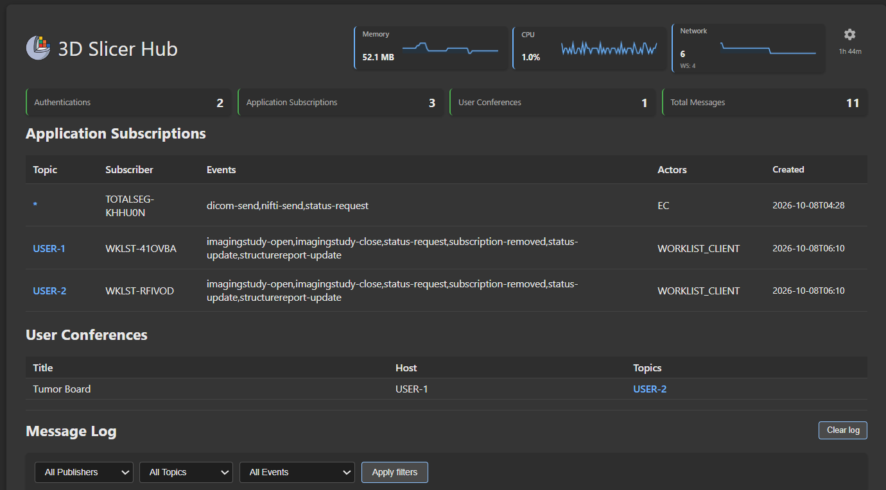
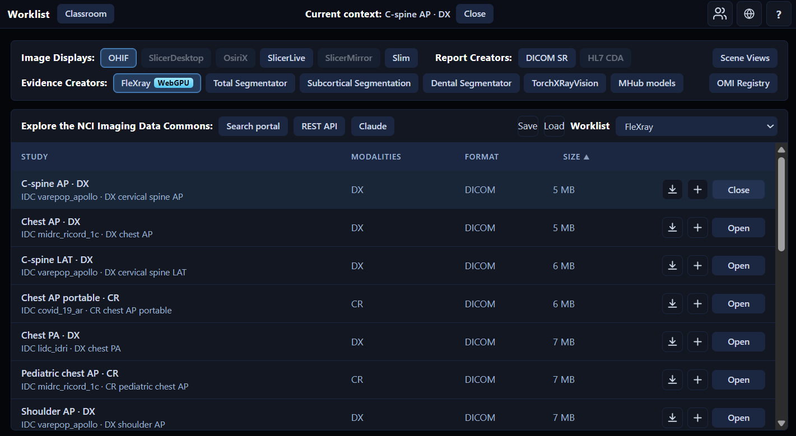
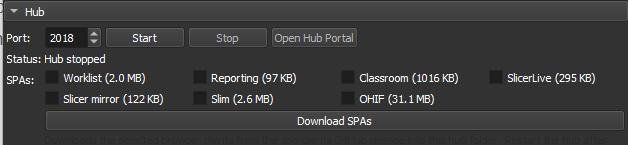
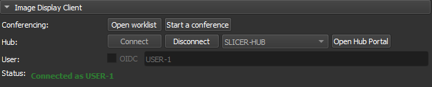

# Slicer WebSub Extension

<p align="center">
  
</p>

The Slicer WebSub extension is a [WebSub](https://www.w3.org/TR/websub/)  messaging infrastructure that connects users of medical image displays, worklists, reporting tools, conferencing tools, remote inference models and AI orchestrators.

## Overview

The original aim of this project was to  promote and develop interoperability in medical imaging applications as a sandbox for the [IHE Integrated Reporting Application](https://profiles.ihe.net/RAD/IRA/) workflow. Over time, it has moved on to supporting the needs researchers and educators.  Supporting [IHE AI Results](https://wiki.ihe.net/index.php/AI_Results) is a work in progress.
 
This repository supplies the **HUB** and the Slicer Qt **Image Display** client connection. Inference workers live in the sister [SlicerWebSub-workers](https://github.com/mbellehumeur/SlicerWebSub-workers) repository. Together with [javascript clients](https://github.com/mbellehumeur/SlicerWebSub-js), the system includes:

- **HUB** actor: a WebSub hub for communication between applications and users
- **WORKLIST_CLIENT** actor: a worklist application (described [here](https://github.com/mbellehumeur/SlicerWebSub-js#worklist-and-classroom))
- **IMAGE_DISPLAY** actor: medical imaging viewers
- **EVIDENCE_CREATOR** actor: medical imaging inference models (described [here](https://github.com/mbellehumeur/SlicerWebSub-workers))
- **REPORT_CREATOR** actor: a DICOM SR reporting example (WIP)
- **IMAGE_ARCHIVE** actor: the [Imaging Data Commons](https://imaging.datacommons.cancer.gov/) and the [3D Slicer](https://www.slicer.org/) DICOM DB as read-only image archives
- **IDENTITY_PROVIDER** actor: authentication / identity provider with integration to the hub [OIDC endpoints](WebSubInterface/hub/docs/oidc.md) or built-in hub anonymous/mock authentication


Javascript applications can easily connect to the hub and publish/receive events with the JS client:

```javascript
import HubClient from '@slicer-hub/client';

const client = new HubClient({
    hub_endpoint: 'http://127.0.0.1:2018/api/hub',
    productName: 'MY-VIEWER',
    events: ['imagingstudy-open', 'imagingstudy-close','status-request','scene-update'],
    autoReconnect: true 
  });

client.onMessage((message) => {
  const event = message?.event;
  if (event === 'imagingstudy-open' || event === 'imagingstudy-close') {
    // 1. Process open / close (load or clear the study)
  } else if (event === 'status-request') {
    // 2. Respond to status-request (e.g. SceneViews / current context)
  } else if (event === 'scene-update') {
    // 3. Update the scene during conferencing
  }
});

await client.connect(); // authenticate + token + subscribe 
```

The extension also includes features for education that are independent of the IHE Integrated Reporting workflow:

- an example [classroom application](https://bellehumeur-engineering.com/classroom-client/) ([demo video](https://youtu.be/ENyYdJ_fHYI))
- an example worklist application for creating, saving, and uploading teaching files and cohorts for class preparation
- conferencing for collaborative viewing and teaching
- a [vanishing brush tool](https://youtu.be/xKQEOs1_9Bg?si=-gtvlB3aeq3KF-dX) for temporary annotations during conferencing
- export to STL for 3D printing

Research and 3D Slicer functionalities, also independent of IHE, are included:

- File transfer between applications 
- Medical Reality scenes communication for conferencing
- SceneViews status on request with the long term goal of inference for multi-application hanging protocols.
- Status-request messaging for using current information from other applications in the workflow
- Slicer Qt Image Display client and DICOM DB study list (same python/websocket client)


File transfer allows inference servers to send their results directly back to the viewers without having to archive them to PACS first.  Research file formats like NIfTI, NRRD, and Zarr can be used.   Transfer is realized with multi-part POST to the hub and then GET retrieves from the receiving applications and service providers.  The file naming policy is decribed [here](WebSubInterface/docs/module/filename-policy.md). 


## Background

Slicer WebSub is an extension of [FHIRcast](https://fhircast.hl7.org/). FHIRcast is the standard replacing Epic’s file drop interface for integration with PACS and reporting systems. It provides a secure event messaging infrastructure using a hub with websocket subscriptions.  The hub expands on the initial FHIRcast design to support research and education with additional data types and it utilizes more of the built-in capabilities of the WebSub infrastructure such as conferencing and chat.  For an overview of common features and differences with FHIRcast see [WebSubInterface/docs/module/hub-description.md](WebSubInterface/docs/module/hub-description.md).


<p align="center">
  
</p>


You can try WebSub integration with the [Slicer WebSub worklist example](https://bellehumeur-engineering.com/worklist-client/). 

<p align="center">
  <a href="https://bellehumeur-engineering.com/worklist-client/">
    
  </a>
</p>


## Extension Features

The extension features a hub and the Image Display client (3D Slicer Qt viewer + DICOM DB). Inference models such as Total Segmentator run as WebSub workers in the sibling [SlicerWebSub-workers](https://github.com/mbellehumeur/SlicerWebSub-workers) repo.

### Hub

The hub is a stateless routing appliance that distributes messages and handles data transfer requests over the websocket and http to each client.

<p align="center">
  
</p>

It can be used without the Slicer extension by running the `hub.py` script.

### Image Display Client

The image display client provides a PACS client type interface to the 3D Slicer viewer. Supported events include imagingstudy-open, imagingstudy-close, dicom-send, and status-request (embedded sceneview).

<p align="center">
  
</p>

It also forwards LiveScene events to the hub and provides access to DICOMDB to the worklist client.
Here is an example of its use:

<p align="center">
  <a href="https://youtu.be/rvaVWOaYgqU">
    
  </a>
</p>

Inference / evidence-creator workers and secure deployment notes: see [SlicerWebSub-workers](https://github.com/mbellehumeur/SlicerWebSub-workers).

## Installation

### Install from the 3D Slicer Extension Manager

1. Open **3D Slicer**
2. Open the **Extension Manager**
3. Search for **Slicer WebSub**
4. Click **Install**
5. Restart 3D Slicer

## Developers

| Path | Purpose |
|------|---------|
| [`WebSubInterface/`](WebSubInterface/) | Slicer module package (`WebSubInterface.py`, `Lib/`, `Resources/`, bundled runtime) |
| `WebSubInterface/hub/` | FastAPI Slicer hub (`hub.py`) |
| `SlicerWebSub-workers/` (sibling) | Inference / evidence-creator workers |
| `WebSubInterface/image_display/` | Slicer image display runtime + CLI |
| `WebSubInterface/python_client/` | Python `hub_client` package |
| [`WebSubInterface/docs/`](WebSubInterface/docs/) | Extension docs (module docs under `WebSubInterface/docs/module/`) |

CMake install copies `WebSubInterface/` into `qt-scripted-modules/WebSubInterface/` (module scripts + bundled folders).

### Quick start (no Slicer WebSub module)

```bash
cd WebSubInterface

# One-time: shared Python client
pip install -e python_client

# Terminal 1 — Hub
cd hub && pip install -r requirements.txt && python hub.py --port 2018

# Terminal 2 — WebSub worker (examples; sibling repo)
python ../SlicerWebSub-workers/neuro_seg/neuro_seg.py --local
# python ../SlicerWebSub-workers/total_segmentator/total_segmentator.py --local

# Terminal 3 — Slicer image display (Slicer required; module NOT required)
Slicer --python-script image_display/run_image_display.py -- --local --topic USER-1
```

Admin UI: http://127.0.0.1:2018/api/hub/admin

See [WebSubInterface/docs/standalone-components.md](WebSubInterface/docs/standalone-components.md) for details.

The Python `hub_client` package remains under [`WebSubInterface/python_client/`](WebSubInterface/python_client/); install and usage examples are documented in the [SlicerWebSub-workers README](https://github.com/mbellehumeur/SlicerWebSub-workers#python-client-usage).

### 3D Slicer extension (dev)

Build from this repo (`CMakeLists.txt` at repo root, module in `WebSubInterface/`). For dev, add the **repo root** to Additional module paths — Slicer discovers `WebSubInterface/WebSubInterface.py`.

Override module root at runtime with `HUB_REPO_ROOT` when needed.

Demo hub presets ship a public OAuth `client_secret` placeholder (mock hub OAuth does not validate it). Do not commit real identity-provider secrets. Install torch / nnU-Net / TotalSegmentator in the **separate Python** that runs service providers—not into 3D Slicer’s Python via the Hub module.

## License

Slicer WebSub is distributed under the [MIT License](LICENSE.txt).

## Acknowledgements

**3D Slicer** — open-source platform for medical image computing from the [3D Slicer community](https://www.slicer.org/). This extension is built for and distributed through the 3D Slicer extension ecosystem.

**Imaging Data Commons** — cloud-based repository of publicly available cancer imaging data from the [National Cancer Institute](https://imaging.datacommons.cancer.gov/). Slicer WebSub uses IDC as a read-only image archive and for worklist / Slim demos.

**TotalSegmentator** was created by the Department of Research and Analysis at University Hospital Basel. If you use it, please cite our Radiology: Artificial Intelligence paper ([free preprint](https://arxiv.org/abs/2208.05868)). If you use it for MR images, please cite the TotalSegmentator MRI *Radiology* paper ([free preprint](https://arxiv.org/abs/2405.19492)).

**nnU-Net** — TotalSegmentator is heavily based on nnU-Net ([preprint](https://arxiv.org/abs/1809.10486)).

**IDC Claude** — builds custom worklists from natural-language queries against the [Imaging Data Commons](https://portal.imaging.datacommons.cancer.gov/) (National Cancer Institute) using Anthropic Claude. Query guidance follows the [IDC skill](https://github.com/ImagingDataCommons/imaging-data-commons-skill).

**idc-index** — official [Imaging Data Commons](https://github.com/ImagingDataCommons/idc-index) Python package for local DuckDB SQL against IDC metadata and DICOM series download URLs; used by the IDC Claude service provider. If you use it in research, cite Fedorov A, et al., *Radiographics* ([2023](https://doi.org/10.1148/rg.230180)).

**OHIF** — open-source zero-footprint viewer from the [Open Health Imaging Foundation](https://ohif.org/).

**Slim** — interoperable slide microscopy viewer from the [Imaging Data Commons](https://github.com/ImagingDataCommons/slim) (National Cancer Institute).

**SlicerLive** — experimental WebGPU live 3D Slicer scenes in the browser from [SlicerLive](https://github.com/pieper/SlicerLive/); used for IRA / slicer-mirror demos served from the hub.

## Standards and trademarks

DICOM® is the registered trademark of the National Electrical Manufacturers Association (NEMA) for its standards publications relating to digital imaging and communications in medicine. FHIR® and related HL7 marks are registered trademarks of Health Level Seven International (HL7). IHE® is a registered trademark of HIMSS. OHIF® is a trademark of the Open Health Imaging Foundation. Imaging Data Commons® is a trademark of the National Cancer Institute. OsiriX® is a registered trademark of Pixmeo SARL.

The Slicer WebSub (including its hub, clients, and documentation) references ideas, workflows, and vocabulary drawn from these standards—such as DICOM objects and metadata, FHIR and FHIRcast-style context and events, and IHE actor roles (for example, Image Display and Evidence Creator)—and product names such as OHIF, and Imaging Data Commons solely to describe interoperability behavior.

Slicer WebSub is not part of these standards. It is not published by NEMA, HL7, or HIMSS, and is not an IHE Integration Profile, a FHIR implementation guide, or a DICOM conformance statement. Use of standard names and terms does not imply endorsement, certification, or official status. All other product and company names are trademarks of their respective owners.
